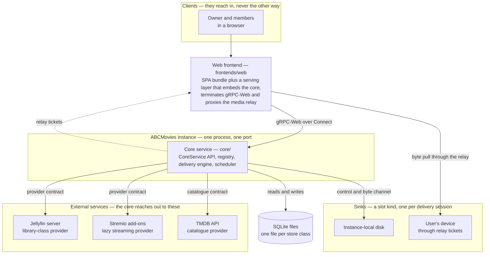
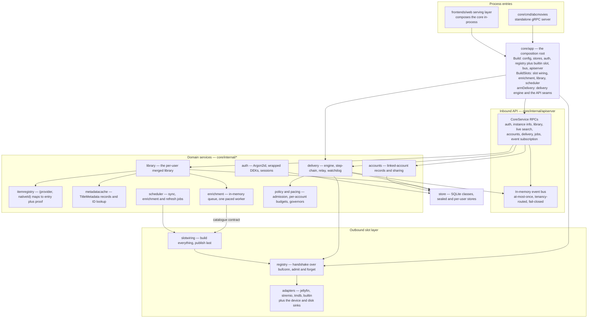
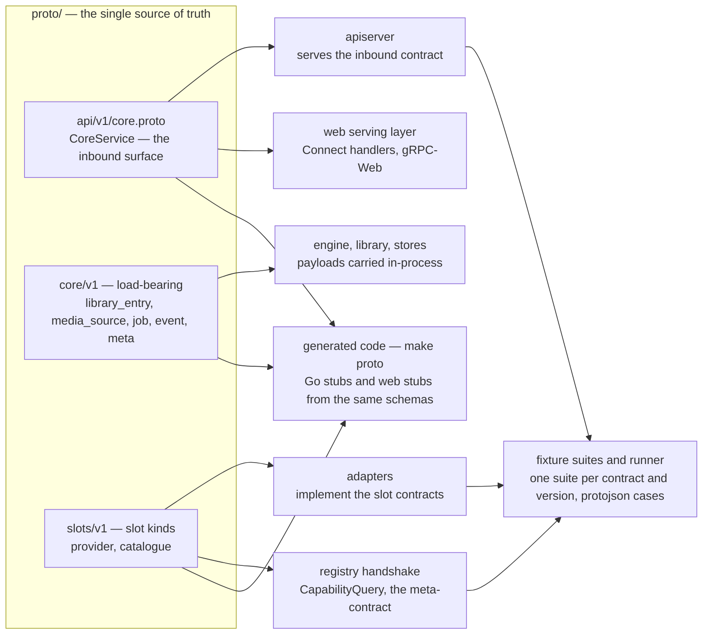
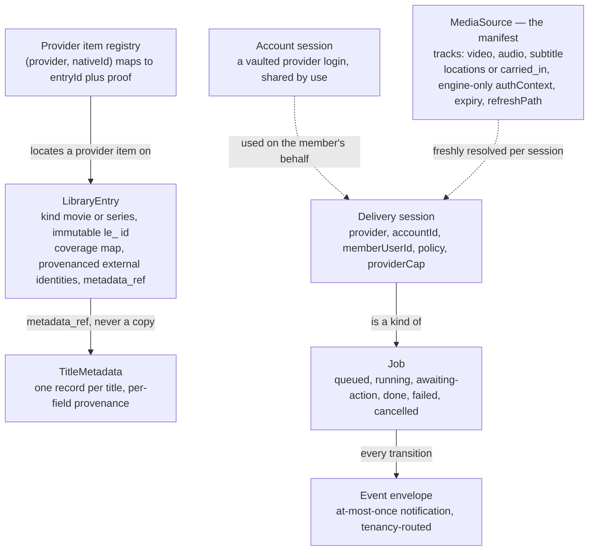
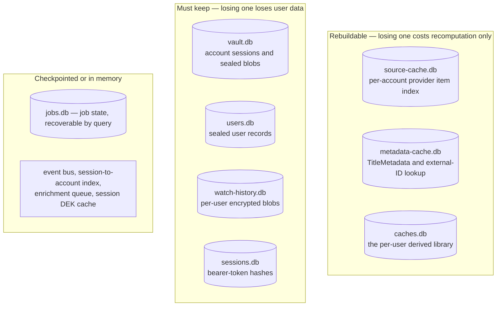
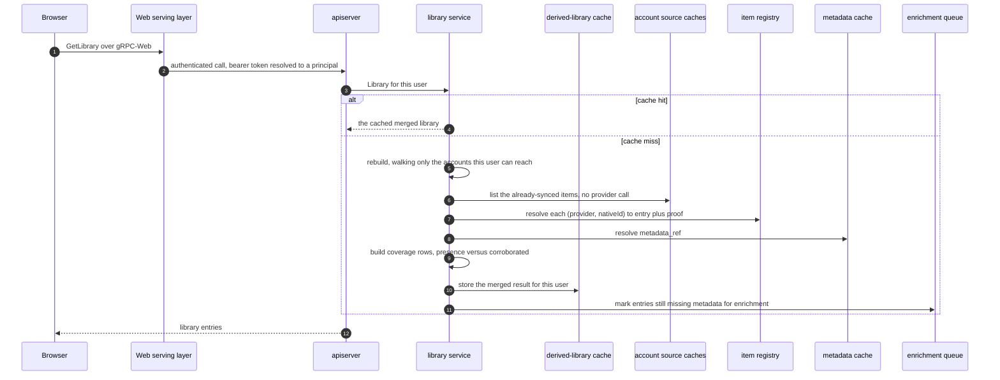
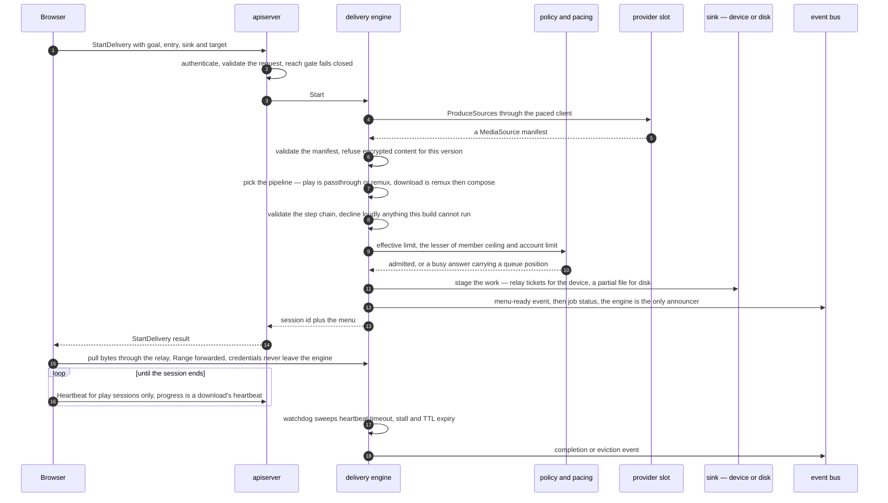
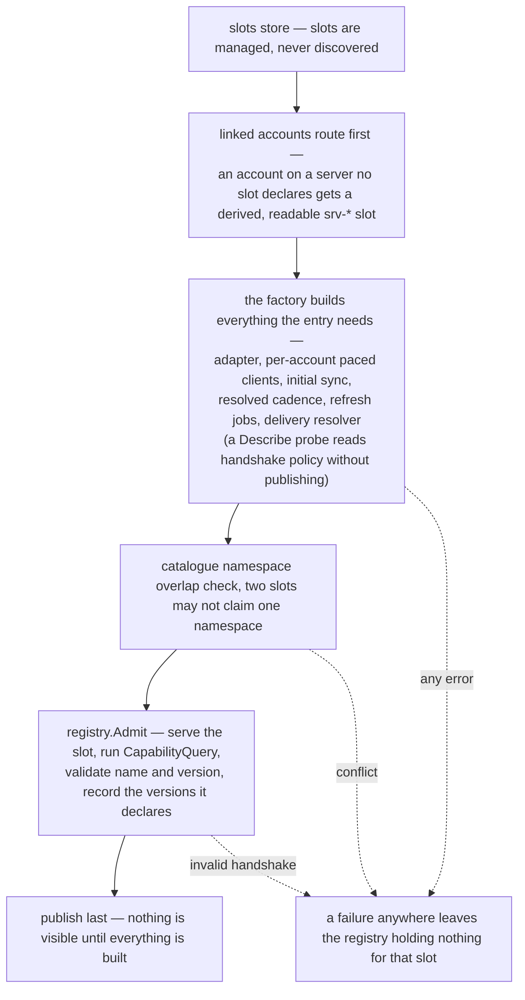
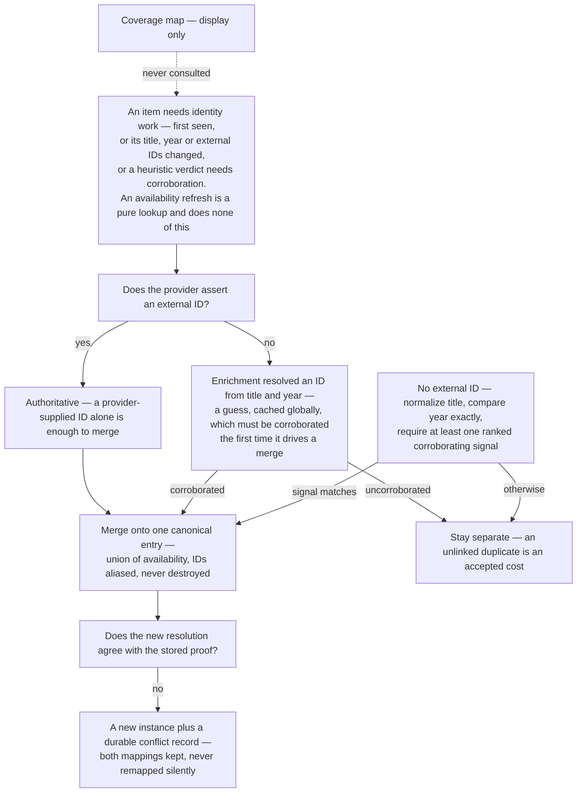
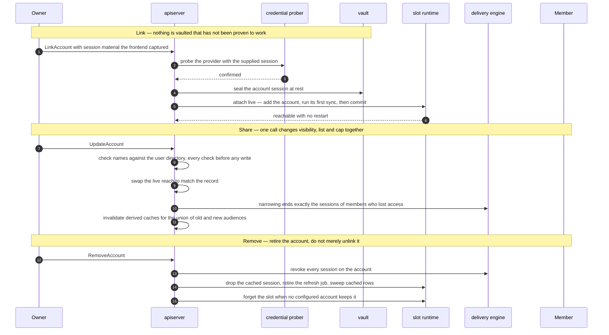

# ABCMovies — the project as a diagram set

**A snapshot of the project at milestone m7 (branch `dev`).** This file is a visual,
rationale-annotated map of the whole system, written for one job: letting someone
rebuild the project from scratch. Its claims describe the code as it stands at m7 and
are frozen, not promises about the future.

## What this document is

Four layers, in order:

1. **Static structure** — what exists: the system boundary, the core's internals, the
   contracts, the data model, the stores.
2. **Behavior** — how it runs: the five flows that carry most of the system.
3. **Why** — the decision map, the things this project refuses to do, the tradeoffs it
   accepted.
4. **How it was made** — the milestone ladder, the build story, the method, and a
   recreation playbook.

Ground rules this file obeys:

- **Links, not copies.** Every value (numbers, cadences, pins, defaults) has exactly one
  home in the reference documents. Here it is linked, never restated — this file must not
  become a second source of truth.
- **Spec versus code.** The documents in `docs/` are the spec; where this file describes
  behavior, it describes what the code at m7 does. Where the spec designs more than the
  code implements yet, the diagram says so.
- **No class diagram — yet.** The protobuf schemas are this project's class model:
  §1.3 and §1.4 cover that ground. A Go class diagram would duplicate both the protos
  and the source and would rot first. If one earns its place later, it belongs in §1.4.

## 1. Static structure

### 1.1 System context

Why it is shaped this way:

- **It orchestrates, it does not invent content.** Everything to the right of the core is
  someone else's service; the instance adds search, merging, playback and sharing on top
  of access the user already legitimately holds (PLAN.md §1.1).
- **In versus out is the one structural rule.** Frontends reach *in* to the API and are
  never slots; slots are declared, handshaked and supervised by the core. The test is
  always *who reaches out to whom?* (PLAN.md §3.1).
- **Guests are in the spec but not in this snapshot** — a guest is a device identity
  (`guest:<deviceId>`), and guest access is deferred past m7: the API authenticates
  principals, and today every principal is an authenticated user.
- **Media bytes never enter a store.** A download lands in a sink; a play streams through
  a relay ticket. No cache in the diagram holds audio or video (PLAN.md §2.4).

### 1.2 Inside the core

Why it is shaped this way:

- **One composition root.** `core/app` is the only package that sees everything; every
  other package receives its collaborators. The web frontend imports this exported seam
  — Go's `internal/` rule makes the internals physically unreachable from `frontends/`,
  so the embedding boundary is compiler-enforced, not convention (RESEARCH.md §2.3).
- **Even in-process slots get a real handshake.** The registry serves each slot on a
  buffer listener and issues an actual `CapabilityQuery` RPC, so the admission path is
  identical whether the transport is in-process, subprocess or network (PLAN.md §2.1).
  Only in-process is accepted by config validation at m7.
- **Adapters never hold the account roster.** The core owns linked accounts and hands
  slots a read view; a slot holds only a per-account session-token cache — two rosters
  would be a shared-mutation trap (TECHNICAL-DECISIONS.md §1.41).
- **One scheduler, many job kinds.** Catalogue sync, enrichment drain and refresh jobs
  are all scheduler entries, which is what makes "background shares the user's pacing
  budget" enforceable in one place (TECHNICAL-DECISIONS.md §1.35).

### 1.3 The contract spine

How each direction travels at m7:

| Direction | Contract | Transport in this snapshot |
| --- | --- | --- |
| Frontends → core (inbound) | `api/v1` | plain gRPC from any non-browser client; the browser speaks gRPC-Web (and Connect) to the web serving layer, which wraps the same handlers — one inbound protocol, never a second dialect |
| Core → slots (outbound) | `slots/v1` plus the meta-contract | in-process gRPC over `bufconn`; config validation rejects any other transport today, though the design keeps transports an open, per-slot set |
| Inside the core | `core/v1` | direct Go calls for state; the event bus is in-process pub/sub with gRPC server-streaming as the subscriber transport |

Why it is shaped this way:

- **The schema is the source of truth.** Anything can implement a contract in any
  language; the transport for each slot is a config value the core reads and never
  assumes (PLAN.md §2.1).
- **Declare, never transmit.** A slot's handshake declares *which versions it speaks*;
  it never sends a schema, and it may only declare a version it has actually passed the
  fixture suite for (PLAN.md §3.3, §3.4).
- **Fixtures are data, not code** — a JSON descriptor plus JSON cases, so any adapter in
  any language can be gated by the same runner (`core/cmd/fixture-runner`), and negative
  cases make vacuous permissiveness a failure (TESTING.md §3).
- **Additive evolution is native** because the encoding preserves unknown fields; `buf
  lint` runs with no disabled rules and the breaking-change gate is on as of v1
  (TECHNICAL-DECISIONS.md §1.10, §1.18, §1.24).

### 1.4 The data model

The invariants, each of which is a design decision with a record:

- **Three identifier kinds stay separate.** The `le_` entry ID is immutable and never
  derived from content; the provider item ID is *availability only* — it locates an item,
  it is never a merge basis; an external identity is a provenanced set of namespace
  claims, not a single key (PLAN.md §2.3).
- **Coverage asserts presence, never identity.** The coverage map is display-only; it can
  never feed merging, which is why presence (cheap, lazy, possibly stale) and identity
  (durable proof) live in different stores (PLAN.md §5.3).
- **The manifest is self-sufficient and engine-only.** After a resolve, the provider is
  not touched again; `authContext` never reaches a frontend or a sink and is never
  logged (PLAN.md §6.2).
- **Account context rides the delivery session, not the source** — that is what lets the
  engine revoke, quota and audit mid-stream (PLAN.md §6.1).
- **Jobs are the record; events are only notifications.** A missed event is recovered by
  querying the job (PLAN.md §9.1, §9.2).

### 1.5 Storage

Why the classes are split this way:

- **Durability is chosen by regeneration cost.** Source, metadata and derived caches can
  be rebuilt from providers and enrichment, so they are clearable; history cannot, so it
  is encrypted and kept (PLAN.md §2.4).
- **One file per store class** so an operator can clear caches without touching the vault
  — and a leaked cache file is not sensitive the way a leaked vault is
  (TECHNICAL-DECISIONS.md §1.16).
- **The identity mapping sits with the source cache** because a lost mapping forces
  whole-library identity re-resolution, while everything else in the rebuildable class is
  cheap to regenerate (PLAN.md §2.3).
- **Sealed at rest.** The vault, the users store and per-user blobs are encrypted before
  they ever reach disk; the vault suite proves ciphertext-on-disk, in-memory-only during
  use, and nothing logged (TESTING.md §6).

## 2. Behavior

### 2.1 Browse and search

The second path, **live search**, is deliberately user-triggered: it walks the lazy
provider slots with a paced search, feeds hits back through the source cache
(usage *is* the refresh), and then rebuilds the same merged view — search itself never
calls a provider in the background (PLAN.md §11, TECHNICAL-DECISIONS.md §1.35).

Why it is shaped this way:

- **The library is derived, never stored globally.** There is no catalogue of everything;
  each user's view is computed from the accounts *they* can reach and cached per user, so
  there is nothing to click that they cannot watch (PLAN.md §5.1).
- **Browse does not touch a provider.** The sync'd index answers instantly; per-title
  probing is how accounts get flagged for scraping, so availability comes from whole-
  catalogue sync, usage-confirmed refresh, or an explicit user request — never a crawl
  (PLAN.md §5.4).
- **Enrichment never blocks a browse.** A miss marks the entry and enqueues it; one paced
  background worker drains the queue, so display improves without slowing the request
  path (TECHNICAL-DECISIONS.md §1.28).

### 2.2 Play or download

Why it is shaped this way:

- **Play and download are one operation with a different goal** — resolve a manifest,
  deliver its tracks; the goal only seeds defaults and the sink differs (PLAN.md §6.1).
- **One session drives exactly one sink**, so backpressure, revocation and audit stay
  unambiguous; the same manifest may back several concurrent sessions, each counted
  separately against policy (PLAN.md §6.4).
- **Admission is one computation at one point.** The engine evaluates the member's live
  ceiling and `min(policy, provider cap)` for the account atomically, so work cannot be
  multiplied by splitting it across shared accounts, and a rejection answers with a queue
  position rather than a dead end (PLAN.md §7.2, §6.5).
- **The engine is the only announcer of delivery-job transitions**, because only the
  engine sees expiry, revocation and TTL evictions that never pass through an API handler
  (TECHNICAL-DECISIONS.md §1.38).
- **Refusal over silent degradation.** A step this build cannot execute — decrypt,
  transcode, live record — is declined and logged, never quietly downgraded to
  passthrough (PLAN.md §2.5, TECHNICAL-DECISIONS.md §1.31).

### 2.3 Slot admission and runtime account linking

Runtime linking follows the same discipline, with no restart:

1. **Link** — the frontend runs the interactive login, the core *probes the session
   before vaulting it*, and only confirmed material is sealed.
2. **Attach** — the account is added to the live slot, its first sync runs, and it is
   committed to the slot, the derived-library set and delivery routing only then: no
   half-wired account is ever visible (PLAN.md §11).
3. **Unlink** — the cached session is dropped, the refresh job retired, cached rows
   swept, and when no configured account keeps the slot, the admission itself is
   forgotten; operator-declared slots keep their config-shaped lifetime
   (TECHNICAL-DECISIONS.md §1.41).

Why it is shaped this way:

- **Publish-last turns rollback into an ordering property.** Building every slot before
  admitting any means a late failure needs no undo machinery — there is simply nothing to
  undo (TECHNICAL-DECISIONS.md §1.39).
- **Verified at add-time, never trusted on declaration** — handshake, then the fixture
  suite, then review, for operator slots and user-declared slots alike (PLAN.md §4).
- **Probe before vault.** The core never stores credential material it has not confirmed
  works against the provider (PLAN.md §3.5).

### 2.4 Identity resolution and merge conflicts

Why it is shaped this way:

- **Conservative matching is a deliberate trade.** Keeping two entries for one film is a
  visible cosmetic cost; merging two different films corrupts identity for every user who
  shares the global metadata cache — so duplicates win (PLAN.md §5.3).
- **Conflicts are durable state, not notifications.** The registry keeps both mappings and
  the conflict is queryable; the event path exists but is deliberately suppressed at m7,
  because there is no operator surface to act on it yet
  (TECHNICAL-DECISIONS.md §1.26).
- **Identity work runs on three triggers only.** Everything else — refresh, availability,
  coverage — is lookup, which is what keeps a provider from being scraped title by title
  (PLAN.md §5.3).
- **Provenance is retained everywhere**, because it is the material a future split or
  bury tool would need, and because a heuristic guess must be distinguishable from an
  assertion (PLAN.md §5.3).

### 2.5 Account lifecycle, sharing and keys

How the keys work, as implemented at m7 (full design: PLAN.md §7.6):

- **Login** — the server derives a password-KEK from the password with Argon2id
  (parameters pinned in TECHNICAL-DECISIONS.md §1.11) and stores only derived material;
  the plaintext password is never persisted.
- **User data** — each user has a random DEK, wrapped by a KEK derived from the password
  and one derived from a one-time recovery key shown at signup; history and playlists are
  sealed under that DEK. No email address is stored, so the recovery key is the only
  recovery path.
- **Account sessions** — sealed in the vault under the instance key; the vault suite
  proves the scoping property the design requires, that a key which unwraps relayed
  account sessions cannot decrypt a user blob.
- **Session key material** — cached per session, in memory by default, evicted with the
  token (TECHNICAL-DECISIONS.md §1.20).
- **Owner-only actions** — link, re-auth and revoke are the owner's alone; sharing is by
  use, so a member never sees a credential (PLAN.md §7.1).

## 3. The why layer

### 3.1 Decision map

Each row is one clause of "what was chosen" and one clause of "why" — the argument lives
in the record it points to, never here.

| Area | Choice | Why, in one clause | Full record | In the code |
| --- | --- | --- | --- | --- |
| Core language | Go | single static binary, first-class protobuf, and the in-process slot constraint means one language anyway | TECHNICAL-DECISIONS §1.1 | repo-root module |
| Inbound API | gRPC; Connect handlers at the web serving layer | one typed protocol; the browser is the hardest client, so it is the frontend's problem, never the core's | TECHNICAL-DECISIONS §1.2 | `core/internal/apiserver`, `frontends/web/serving` |
| Contract schemas | Protobuf compiled by buf | unknown-field preservation makes the additive versioning rule native | TECHNICAL-DECISIONS §1.10, §1.18 | `proto/` |
| Repository layout | proto, core, adapters, frontends, fixtures, milestone tests beside the component | mirrors the plan's own separations; Go's `internal/` rule enforces the embedding seam | TECHNICAL-DECISIONS §1.3 | tree root |
| Stores | SQLite, one file per store class | zero-ops single files, and caches stay clearable without touching the vault | TECHNICAL-DECISIONS §1.16 | `core/internal/store` |
| API authentication | opaque bearer token, stored as a hash | one mechanism for every client, with no JWKS or issuer machinery | TECHNICAL-DECISIONS §1.12 | `core/internal/auth`, `apiserver/auth.go` |
| Fixture format | JSON descriptor plus JSON cases | the conformance gate must be language-neutral, so it is data | TECHNICAL-DECISIONS §1.19 | `fixtures/`, `core/cmd/fixture-runner` |
| First provider | Jellyfin | open source, stable REST API, a clean "what is in this library" index | TECHNICAL-DECISIONS §1.8, RESEARCH §2.1.1 | `adapters/jellyfin` |
| First catalogue | TMDB | free, and IMDb links resolve in both directions in one round trip | TECHNICAL-DECISIONS §1.27 | `adapters/tmdb` |
| Sync capability name | whole-catalogue sync declares `browse` v1 | the catalogue index *is* the browse surface of a library provider | TECHNICAL-DECISIONS §1.21 | `adapters/jellyfin` |
| Handshake policy | an opaque key-value map on the response | typing vocabulary early cannot be undone cheaply; promotion stays additive | TECHNICAL-DECISIONS §1.23 | `registry`, `slotwiring` |
| Provider namespace | the slot instance id, never the adapter name | two deployed servers of one adapter can number items identically | TECHNICAL-DECISIONS §1.25 | `itemregistry`, `slotwiring` |
| Enrichment execution | one in-memory queue, one paced background worker | the converged pattern across media servers; never in the request path | TECHNICAL-DECISIONS §1.28 | `core/internal/enrichment` |
| Pipeline model | typed step-chain; v1 executes passthrough, remux, compose | real sequencing, honest decline — a chain that cannot run fails loudly | TECHNICAL-DECISIONS §1.31 | `delivery/pipeline.go` |
| Delivery sinks | two co-equal v1 sinks, device and disk | both are needed for downloads to be usable, and both stay plain config | TECHNICAL-DECISIONS §1.13 | `slotwiring`, `delivery` |
| Policy vocabulary | one admission key plus pacing keys enforced; the rest validated and recorded | record the audit trail without claiming enforcement that cannot honestly happen | TECHNICAL-DECISIONS §1.34 | `core/internal/policy` |
| Background budget | background work shares the account's pacing budget | a stream-occupancy heuristic cannot distinguish load, so an honest bound beats a decorative one | TECHNICAL-DECISIONS §1.35 | `core/internal/pacing` |
| Tenancy checks | one reach check feeds both the API and the bus, fail-closed | "who may see this" must have exactly one answer or the implementations drift | TECHNICAL-DECISIONS §1.36 | `apiserver`, event bus |
| Job announcements | the engine's hook is the only announcer | only the engine observes expiry, revocation and TTL evictions | TECHNICAL-DECISIONS §1.38 | `delivery`, `apiserver.RecordJobStatus` |
| Slot publication | publish only after every slot has built | a failed build then leaves nothing behind as an ordering property, not a cleanup | TECHNICAL-DECISIONS §1.39 | `slotwiring.SetupAll` |
| Account roster | the core owns it; slots get a read view | two rosters would be a shared-mutation trap on every add and remove | TECHNICAL-DECISIONS §1.41 | `accounts`, `slotwiring` |
| Sharing edits | one `UpdateAccount` call for visibility, list and cap | a half-set record is then unrepresentable | TECHNICAL-DECISIONS §1.42 | `apiserver.UpdateAccount` |
| Instance discovery | a public `GetInstanceInfo` meta-RPC | a client that hardcodes instance parameters breaks the day an operator overrides them | TECHNICAL-DECISIONS §1.43 | `apiserver` |
| Delivery idempotency | deferred; the session cap bounds double-starts | a retry refinement on top of an existing structural guard, not the guard itself | TECHNICAL-DECISIONS §1.30 | `delivery` admission |
| Merge-conflict events | emission proven, delivery suppressed | no operator surface can act on them yet, so the durable record is the contract | TECHNICAL-DECISIONS §1.26 | `itemregistry` |
| Pre-v1 contract evolution | breaking changes allowed, gate off — closed at v1 | with no external consumers, version-bump ceremony bought nothing; the gate is now on | TECHNICAL-DECISIONS §1.24 | `Makefile` (`buf breaking`) |
| Output naming | arr/TRaSH-style default template | deliverables then land in self-hosted tooling's expected format untouched | TECHNICAL-DECISIONS §1.15 | delivery naming code |
| Web playback | start-delivery, then render the relay URL into a video element | the simplest honest path; the bearer token lives only for the page's lifetime | TECHNICAL-DECISIONS §1.33 | `frontends/web` |
| Product decisions | recorded in the PLAN decision log, implementation choices in their own document | one home each, so no fact is duplicated across documents | PLAN.md §11 | `docs/` |

### 3.2 Things this project refuses to do

The negative space matters as much as the design when you are rebuilding it: several of
these are easy to violate by accident.

| Refusal | Stated where | Enforced or proven by |
| --- | --- | --- |
| No global catalogue store — the library is derived per user | PLAN.md §2.4, §5.1 | per-user derived cache plus account-precise invalidation |
| Media bytes are never cached by any store | PLAN.md §2.4 | milestone test asserting bytes never reach a store |
| Frontends are never slots; the core does not know they exist | PLAN.md §3.1 | separate `frontends/` tree; the only seam is `core/app` |
| Events are never the record; jobs are | PLAN.md §9.1, §9.2 | `GetJob` is authoritative; the bus is at-most-once and queryable |
| Coverage never drives identity or merging | PLAN.md §5.3 | presence and proof live in different stores; negative merge fixtures |
| Nothing merges, and no provider item remaps, silently | PLAN.md §5.3 | durable conflict record keeping both mappings; milestone tests |
| Availability is never found by probing titles one by one | PLAN.md §5.4 | three sanctioned routes only; a lazy provider refuses catalogue sync |
| A failed claim is a rejection, never a downgrade | PLAN.md §2.5 | fixture gate with mandatory negative cases; loud declines in the engine |
| No email addresses are stored | PLAN.md §2.2, §7.6 | auth stores derived material only; the recovery key is the reset path |
| Interactive login is not the core's job | PLAN.md §3.5, §7.5 | the core probes supplied sessions before vaulting; frontends run the flow |
| Background work can never exceed the user's own limits | PLAN.md §5.4 | one shared per-account pacing budget |
| Slots are declared, never discovered | PLAN.md §4 | admission is config-driven; nothing is scanned for |
| The core never branches on an adapter's policy keys | TECHNICAL-DECISIONS §1.23 | the core stores the map opaquely |
| One fan-out, one enforcement point | PLAN.md §7.2 | admission computes the ceiling once, regardless of fan-out |

### 3.3 Tradeoffs accepted

| Chosen | What it bought | What it cost | How the cost is contained |
| --- | --- | --- | --- |
| In-process slots as the only transport today | zero operational overhead; adapters are plain Go | a crash in a slot can take down the core; Go-only | the isolation guarantee is documented as holding for subprocess and network transports; the transport stays a per-slot config value |
| Proxy-only delivery (all bytes cross the instance) | uniform policy, audit and revocation in one place | bandwidth and CPU on the host | accepted in the spec; egress routing is designed and deferred |
| Server-held custody as the default | the simplest experience for users | the operator can decrypt the vault by design | labeled honestly as policy, not proof; the sidecar is the provable path, deferred |
| SQLite, one file per class | no services to install; caches are disposable | no cross-store transactions | designed around: jobs are queryable, caches rebuildable |
| An ephemeral in-memory event bus | no replay or persistence machinery | notifications can be lost | the job is the record; routing fails closed rather than spraying |
| Conservative matching | never merges two different films | visible duplicate entries | accepted as the cost; provenance is retained for a future correction tool |
| One paced enrichment worker | predictable, provider-friendly load | a backlog enriches slowly | it is never on the request path, so display quality never blocks a user |
| A hand-written Connect serving adapter | the core stays a pure gRPC service | adapter code owned by the frontend | integration-tested end to end; the alternatives were evaluated and recorded |
| One process (the web serving layer embeds the core) | one port, trivial self-hosted deployment | vertical scaling only | the composition seam keeps embedding a wiring fact, not an architectural one |

### 3.4 Deferred, not forgotten

Specified and designed, deliberately absent from this snapshot — do not read their absence
as a design gap:

DRM slot and content-key cache (v2 per SCOPE.md), sidecar custody, egress routing, guests
and the `guest:<deviceId>` library cache, user-declared slots, a CLI frontend, subprocess
slot supervision, session coalescing, scoring profiles, entry-level correction tools, and
two-factor or external identity-provider login.

## 4. How this project was made

### 4.1 The milestone ladder

Milestones are ordered by **risk**, not by section number: the trickiest logic and the
most load-bearing boundaries are owned while the codebase is still small.

| # | Milestone | What it proves | State at this snapshot |
| --- | --- | --- | --- |
| M0 | Walking skeleton | the shape exists: contracts, storage classes, handshake fixtures, one sync call and one event to a client, vault suite green | green |
| M1 | First library-class provider | a real catalogue lands in the account source cache and rebuilds from the provider; registry shows declared capability versions | green |
| M2 | Identity, matching, merge | external-ID merges, heuristic merges, negative fixtures refusing uncorroborated merges, recycled-ID handling, durable conflict records | green |
| M3 | Enrichment | structured metadata with per-field provenance, abstaining on ambiguity, off by default | green |
| M4 | Delivery engine | manifest fixtures, one passthrough play and one remux download end to end, session index, heartbeat, TTL, revocation | green |
| M5 | First frontend | the browser renders library and plays a title over real gRPC-Web against a fake provider | green |
| M6 | Sharing, policy, audit | `min(policy, cap)` at one point, revocation kills live sessions, member-scoping tested rather than asserted | green |
| M7 | Lazy providers and pacing | no background probing, usage is the refresh, background shares the user's budget, busy answers carry a position | green — this is the snapshot (`MILESTONE` = m7) |
| M8 | DRM slot and extra sinks | decrypt-to-clear composition, content-key cache, a second sink with no core change | not started |
| M9 | Sidecar custody and egress | relay-through-owner, off-by-default egress routing | not started |

Notes for a rebuilder:

- **The release boundary is not the ladder.** v1 ships M0–M6 (SCOPE.md); M7's machinery
  was designed in the plan as v2-side work and is what this snapshot adds.
- **"Green" means the check recipe**, run locally — the same recipe CI runs: lint, schema
  lint and breaking gate, build, unit and integration tests with the race detector, the
  fixture suites, and the vulnerability scan.

### 4.2 The build story

Observed from this repository's history — the docs-first project begins on 2026-08-16,
when the legacy implementation that had lived in this repo was removed and the
specification was imported:

| When | What landed |
| --- | --- |
| 2026-08-16 | **Docs-first import at M0** — the specification and process documents exist before any implementation; the load-bearing contracts are then added one per commit, each with its fixture suite and round-trip tests, *before* any service code |
| 2026-08-19 → 08-22 | M0 skeleton — stores, the gRPC server, auth and sessions, the registry and bus seams, the first milestone test, a small test web client, and the CI gate with its breaking-change baseline |
| 2026-08-23 → 08-24 | M1 then M2 in quick succession — the first provider adapter and provider-contract round-trips, then matching with proofs, the derived per-user library, and the merge fixtures; images tagged m1 and m2 |
| 2026-08-25 → 08-26 | M3 enrichment — metadata cache, merge engine, corroboration gate, then the TMDB catalogue adapter with its fixtures |
| 2026-08-27 → 08-30 | M4 delivery engine (sinks, step-chains, end-to-end wiring), then M5 — the account and play API surface, linked-account wiring, the web client over the real wire, decisions recorded as the milestone closed |
| 2026-09 | a deliberate quiet month — no commits between M5 and M6 |
| 2026-10-04 → 10-06 | M6 — the policy vocabulary, `min(policy, cap)` enforcement, member-scoping at the API boundary, the engine as sole event announcer, owner-only rosters; then the v1 contract baseline is set and the breaking-change gate is switched on |
| 2026-10-06 → 10-07 | M7 — the additive lazy-provider contract and the Stremio adapter, pacing with busy-answer queue positions, live search, `GetInstanceInfo`, runtime account attach; the milestone bump to m7 closes the snapshot |

Three patterns are visible in the history and are worth copying:

1. **Fixtures and tests land with the capability, not after it** — every milestone's
   commits mix implementation and the fixtures that pin it.
2. **Decisions are recorded at the moment they are made** — commits such as "record the
   phase-3 decisions" exist, so reasoning is never lost in code review.
3. **Each milestone closes with its own bump commit**, carrying the docs catch-up and any
   decisions the milestone surfaced — which keeps the release marker honest.

### 4.3 The method

The process is as reproducible as the code:

- **Spec before build.** `PLAN.md` fixes what the system is; implementation choices have
  their own document; scope has its own. Nothing is decided only in code.
- **One requirement → one fixture**, written *before* the implementation that satisfies
  it. A requirement without a fixture is not done.
- **Reject, never downgrade.** A failed fixture is a rejection — in the registry, in
  dependency updates, in the engine's pipeline declines.
- **Walking skeleton first**, then vertical slices: a request enters the API, crosses the
  core, touches one store and returns — before the next request is started.
- **Risk-ordered milestones**: conformance gate first (drift is the biggest risk), then
  identity (trickiest logic), then the delivery boundary (load-bearing), then the
  compounding work — sharing, DRM, custody — last.
- **Growth is declared, not modified.** A new slot or frontend never touches the core; if
  it does, that is a design violation to review, not a normal step.
- **Every value has one home.** Numbers live in exactly one document; the others link.
- **local == CI.** One check recipe, run by both; no command is ever invented.
- **Secrets discipline from day one**: no secrets in the repo, vault material never
  logged, a dedicated suite that CI never skips.

### 4.4 Recreation playbook

If you were rebuilding this from an empty directory, the order that works:

1. **Read `PLAN.md` §1 and `SCOPE.md`** until you can state what v1 is and what it
   refuses to do. *Checkpoint: you can explain why coverage never merges anything.*
2. **Write the load-bearing schemas first** (`proto/abcmovies/core/v1/`) with round-trip
   and fuzz tests. *Checkpoint: encode/decode is lossless and unknown fields survive.*
3. **Build the walking skeleton (M0)**: one store per storage class, Argon2id auth with
   wrapped DEKs, the registry with a real handshake, the API server, the event bus, one
   sync call and one event reaching a client. *Checkpoint: `core/tests/m0` and the
   handshake fixtures pass.*
4. **Build the fixture runner and suites as data** before adapters that need them.
   *Checkpoint: a deliberately invalid case is rejected by the negative suite.*
5. **M1 — one library-class provider and the account source cache.** *Checkpoint: a
   catalogue syncs and the cache rebuilds from the provider.*
6. **M2 — identity**: the item registry, matching with negative fixtures, the derived
   per-user library. *Checkpoint: no merge happens without corroboration.*
7. **M3 — enrichment**: metadata records with provenance, the single paced worker.
   *Checkpoint: ambiguity abstains instead of guessing.*
8. **M4 — delivery**: manifest validation, the step-chain with loud declines, both sinks,
   the relay, heartbeat and TTL. *Checkpoint: one play and one download end to end, and
   media bytes never touch a store.*
9. **M5 — the frontend**: terminate gRPC-Web in the frontend's serving layer and embed
   the core through its exported seam. *Checkpoint: the browser plays a title over the
   real wire.*
10. **M6 — sharing and policy**: one enforcement point, fail-closed routing,
    owner-only mutations. *Checkpoint: revocation kills live sessions in a test.*
11. **M7 — lazy providers and pacing**: usage-confirmed refresh, one shared budget.
    *Checkpoint: a lazy provider refuses catalogue sync and no background probing exists.*
12. **After that, follow the roadmap**: M8 DRM and sinks, M9 custody and egress — or stop
    at the release boundary if v1 is your goal.

Throughout: record every product decision in the plan's decision log as it is surfaced,
run the check recipe at each checkpoint, and keep the docs the source of truth — if code
and docs disagree, that is a conversation, not a coin flip.

## 5. Where every answer lives

| When you need to know | Read |
| --- | --- |
| What the system is, how the parts work, what was decided about the product | `PLAN.md` |
| What v1 ships, and what "done" means for the release | `SCOPE.md` |
| How it is built and kept buildable; the milestone roadmap | `IMPLEMENTATION.md` |
| Which technology was chosen, and why | `TECHNICAL-DECISIONS.md` |
| What "tested" means; the fixture and vault suites | `TESTING.md` |
| How changes are integrated and shipped | `CI-CD.md` |
| What a developer machine needs; reproducibility | `ENVIRONMENT.md` |
| Running a live instance: deployment, keys, capacity | `OPERATIONS.md` |
| What is protected, against whom, and which test proves it | `THREAT-MODEL.md` |
| The feasibility evidence behind a choice | `RESEARCH.md` |
| The rules for working in this repository | `AGENTS.md` |
| A visual map with the rationale attached — this file | `DIAGRAM.md` |
